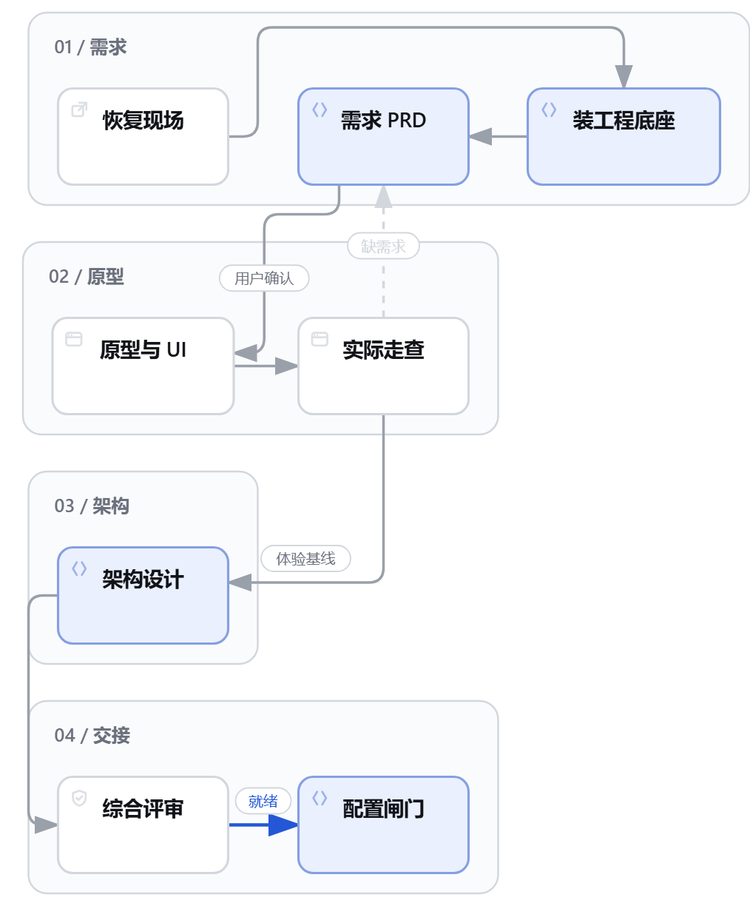
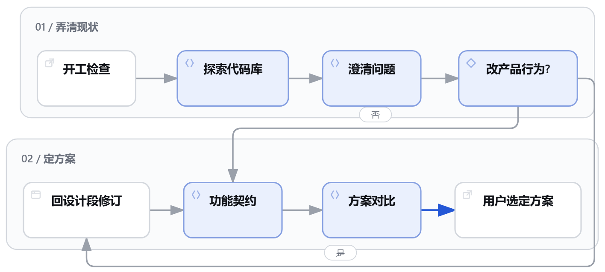
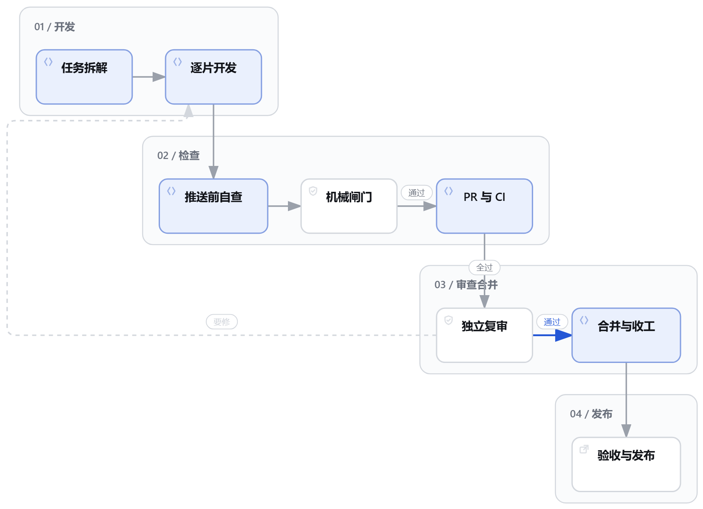
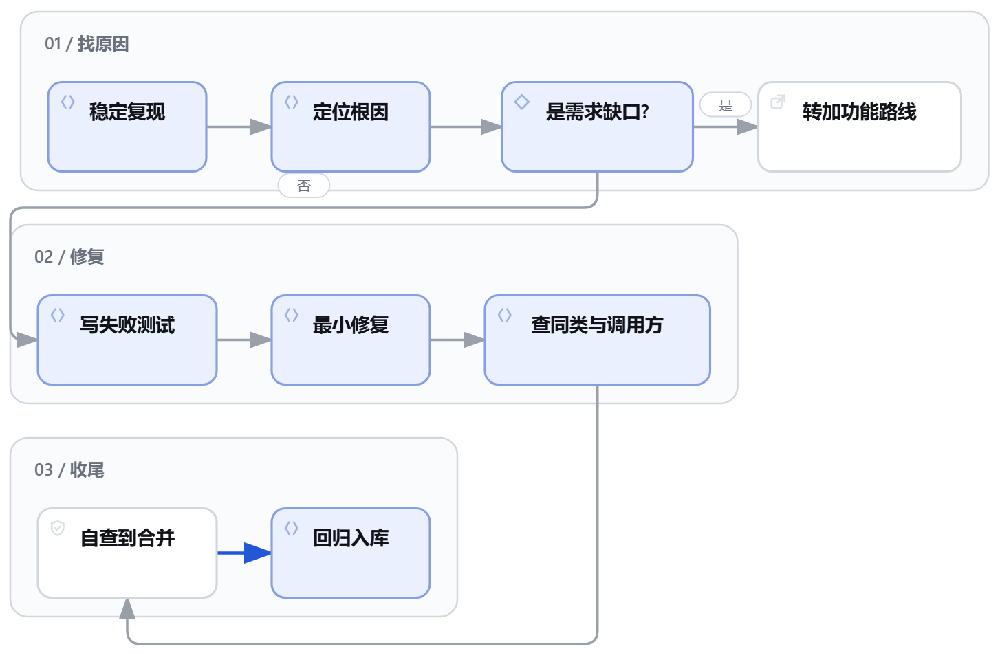

# Product Dev

**面向 Claude Code 和 Codex 的产品开发工作流（0.2.1）。** 从产品想法、功能需求或 bug 出发，Product Dev 会先查项目现状，判断该走哪条路线，再把需求确认、方案设计、实现、验证和审查接成一条可接续的流程。

[快速开始](#快速开始) · [怎么用](#怎么用) · [流程图](#流程图) · [参考与许可](#参考与许可)

## Product Dev 怎么推进一次任务

你从**同一个入口**描述目标、现状和想先做到哪一步。Product Dev 判断需要哪些阶段，沿用项目已有的规则和检查，并把前一阶段确认的结果带进下一阶段。

1. **判断路线。** 先读项目规则、工作区和已有记录。新项目从需求开始，加功能先梳理现有行为，修 bug 先复现。小改动、纯文档和套件维护有各自的短路线。
2. **推进当前阶段。** 例如做新产品时，先确认需求，再做原型走查和架构设计。功能改动进入开发前，先写清验收标准。你也可以只做设计、复审或验收中的一段。
3. **交付可核对的结果。** 每阶段有产物和通过条件，交接时说明已完成、已验证和待确认的事项。接着做以前的任务时，可以直接提供相关分支、PR 或设计文档。

## 快速开始

### Claude Code

在终端安装。

```bash
claude plugin install product-dev --marketplace ac0033/skills
```

较早的版本可以在终端分两步安装。

```bash
claude plugin marketplace add ac0033/skills
claude plugin install product-dev@ac0033-skills
```

打开 Claude Code，在输入框用 `/product-dev:product-dev` 加上你的任务。若在现有会话安装后尚未看到入口，可运行 `/reload-plugins` 或重新启动 Claude Code。

### Codex

在终端运行下面的命令。需要支持 `codex plugin` 子命令的 Codex CLI。

```bash
codex plugin marketplace add ac0033/skills
codex plugin add product-dev@ac0033-skills
```

在 Codex 桌面端的输入框技能列表选择插件下的 `product-dev`。CLI 中可用 `/skills` 选择 `product-dev:product-dev`。桌面端若仍显示旧列表，可重启后再试。

### 其他 Agent

安装一个自包含的 `product-dev` 技能包即可。按[其他 Agent 安装指南](INSTALL.md)导入或配置，保留包内资料和脚本。

### 试一句

> 我想做一个给读书会用的活动报名工具。先梳理参与者和组织者的需求，给出第一版范围和验收标准。等我确认需求后再做原型。

<details>
<summary><strong>升级已有的 GitHub 市场安装</strong></summary>

Claude Code 在终端运行下面的命令，然后重新启动。

```bash
claude plugin marketplace update ac0033-skills
claude plugin update product-dev@ac0033-skills
```

Codex 在终端运行下面的命令，然后重新启动桌面端。

```bash
codex plugin marketplace upgrade ac0033-skills
codex plugin add product-dev@ac0033-skills
```

</details>

## 怎么用

在目标项目目录开始对话。把**目标、已知约束、你希望停下确认的阶段**交给 Product Dev。比如把「加个候补」说成「给活动报名加候补，按报名时间递补。先写清规则和验收标准，等我确认后再实现」。

| 你要做什么 | Product Dev 先做什么 | 你能用什么验收 |
| --- | --- | --- |
| 从零做一个读书会报名工具 | 建立工程底座，梳理用户、问题与范围 | 需求文档、可操作原型、架构和实施交接 |
| 给现有报名页加候补 | 核对报名流程，找出受影响的行为 | 功能契约、边界用例、方案与验证证据 |
| 修复取消报名仍占用名额 | 复现问题、定位根因并写失败测试 | 修复与回归测试，可对照修前和修后的结果 |
| 改按钮文案或补安装说明 | 判断影响范围，走小改动或纯文档路线 | 对应改动和检查结果 |
| 检查工程套件版本 | 对照安装状态和项目差异 | 漂移清单与可审的升级范围 |

询问可行性时，Product Dev 先做只读分析。明确要求实施时，它在授权和项目规则内推进。新项目的工程底座安装会先说明目标目录。生产发布、回滚和破坏性迁移需要对应授权。

**工程套件需要单独安装吗？** Product Dev 已带 `engineering-kit`，可以直接读取规则和调用随附脚本。新项目在获准开工后，把规则、模板和闸门同步进项目。已有项目沿用自己的检查机制，需要引入或升级套件时再按授权同步。

## 流程图

新项目和加功能各有准备阶段，后续共用同一条交付路线。修 bug 从复现和根因入手，再接到交付后半段。点击任一图可以放大查看。

### 新项目 · 从想法到实施就绪

先确认需求，再用原型走查验证体验。综合评审通过后配置检查命令，获准实施才进入交付段。

<a href="docs/images/product-dev/new-project.png"></a>

### 加功能 · 从现状到选定方案

先探索现有代码和行为。改变产品行为时回到设计阶段修订受影响的部分，再确认验收标准与实施方案。

<a href="docs/images/product-dev/feature.png"></a>

### 共用交付 · 从任务拆解到发布

图中采用 PR 复审顺序。若项目配置为推送前复审，独立复审在机械闸门通过后、推送前执行。生产发布按任务范围和授权执行。

<a href="docs/images/product-dev/delivery.png"></a>

### 修 bug · 从复现到回归入库

先判断是实现故障还是需求缺口。确认属于实现故障后，用失败测试固定复现条件，修复并通过相应检查。

<a href="docs/images/product-dev/bug-fix.png"></a>

## 参考与许可

- **完整流程**见[入口技能](product-dev/skills/product-dev/SKILL.md)和[工程流程说明](product-dev/skills/product-dev/references/process.md)，各阶段的工具、验收证据和复审顺序都在这里。
- **组件与版本**见[组件清单](COMPONENTS.md)。可用工具随宿主而异，流程文档说明了按路径读取内部技能和派发子代理的替代方式。
- **测试与许可**见[测试与行为用例](evals/cases.md)、[MIT](LICENSE)和[第三方声明](product-dev/THIRD_PARTY_NOTICES.md)。在仓库根目录运行 `node --test evals/*.test.mjs` 可检查插件入口、装配、链接和版本一致性。
