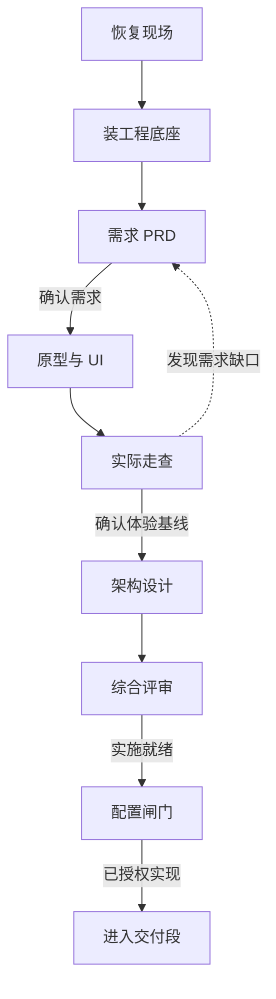
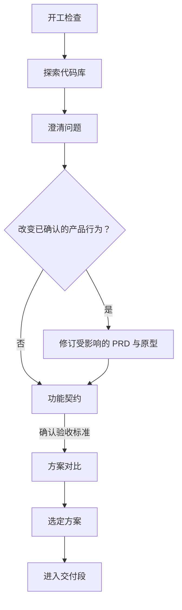
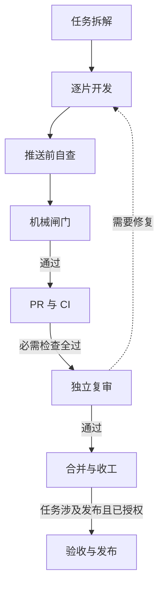
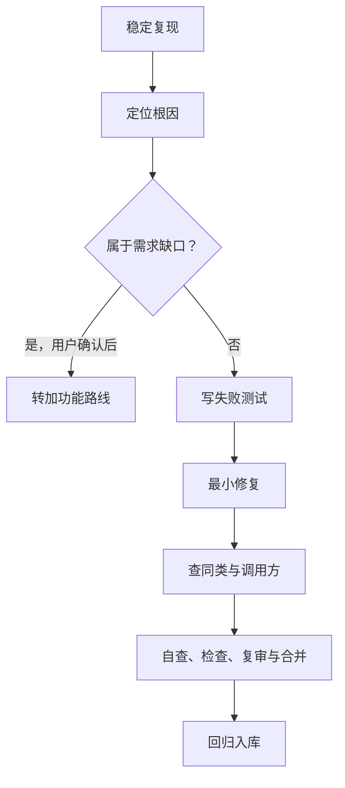

# Product Dev

**Claude Code 与 Codex 的产品开发插件（0.2.1）。** 给它一个产品想法、功能请求或故障现象，它会检查项目现状、选择对应的开发路线，并告诉你下一步会交付什么、怎样验收。

[快速开始](#快速开始) · [怎么用](#怎么用) · [流程图](#流程图) · [组件与许可](#组件与许可)

## 快速开始

### Claude Code

在 Claude Code 中运行下面的命令。

```text
/plugin install product-dev --marketplace ac0033/skills
```

较早的版本可以分两步安装。

```text
/plugin marketplace add ac0033/skills
/plugin install product-dev@ac0033-skills
```

用 `/product-dev:product-dev` 加上你的任务即可显式调用。首次安装后如果入口尚未出现，在 Claude Code 中运行 `/reload-plugins`。

### Codex

在终端运行以下命令。需要支持 `codex plugin` 子命令的 Codex CLI。

```bash
codex plugin marketplace add ac0033/skills
codex plugin add product-dev@ac0033-skills
```

在 Codex 桌面端打开输入框的技能列表，选中插件下的 `product-dev`。CLI 中可用 `/skills` 选择 `product-dev:product-dev`。桌面端如果还显示旧列表，重启后再试。

### 试一句

```text
我想做一个给读书会用的活动报名工具。先梳理参与者、组织者的需求，
给出第一版范围和验收标准。等我确认需求后再做原型。
```

**已从 GitHub 市场安装过？** Claude Code 可先运行 `/plugin marketplace update ac0033-skills`，再运行 `/plugin update product-dev@ac0033-skills`。Codex 可先运行 `codex plugin marketplace upgrade ac0033-skills`，再运行上面的 `codex plugin add` 命令。

## 怎么用

在目标项目目录打开对话，告诉插件**你要达成什么、先做到哪一步**。接着做以前的任务时，附上相关分支、PR 或设计文档，插件会核对当前状态后再接续。

| 你的任务 | 插件先做什么 | 你会看到什么 |
| --- | --- | --- |
| 「从零做一个读书会报名工具」 | 建立项目底座，澄清用户、问题与范围 | 可验收的需求、可操作的原型、架构和实施交接 |
| 「给现有报名页加候补，名额空出时递补」 | 核对现有报名流程，找受影响的行为 | 功能契约、边界用例、方案与验证证据 |
| 「已取消的报名仍占用名额，帮我修」 | 复现问题、定位根因，先写失败测试 | 修复与回归测试，能对照修前和修后的结果 |
| 「改一下按钮文案」「补 README 的安装说明」 | 判断影响范围，走小改动或纯文档路线 | 直接的改动及对应检查结果 |
| 「检查工程套件的版本和漂移」 | 检查安装状态与项目差异 | 差异清单。安装、升级或回滚按授权执行 |

例如，把「加个候补」说成「给活动报名加候补，按报名时间递补。先把规则和验收标准写清，等我确认后再实现」，你就能在代码改动前核对递补顺序和异常场景。

**执行边界**

- 询问可行性时，插件先做只读分析。明确要求实施时，插件按当前授权和项目规则推进。
- 已有项目沿用自己的规则与检查。新项目路线可以安装工程套件，明确要求开工后，插件会说明目标目录再执行。
- 检查与审查随项目配置和风险调整。生产发布、回滚和破坏性迁移需要对应授权。

## 流程图

所有任务都从同一入口开始。**新项目**和**加功能**各有准备阶段，之后进入共用交付段。**修 bug** 从复现开始，修复后接入交付段的检查与审查。小改动、纯文档和套件维护走相应的短路线。

<details open>
<summary><strong>新项目 · 从想法到实施就绪</strong></summary>



</details>

<details>
<summary><strong>加功能 · 从现状到选定方案</strong></summary>



</details>

<details>
<summary><strong>共用交付 · 从任务拆解到合并</strong></summary>

以下是使用 PR 复审流程时的顺序。项目若采用推送前复审，独立复审在机械闸门通过后、推送前执行。



</details>

<details>
<summary><strong>修 bug · 从复现到回归入库</strong></summary>



</details>

完整步骤、工具、通过条件与两种复审顺序见[入口技能](product-dev/skills/product-dev/SKILL.md)和[工程流程说明](product-dev/skills/product-dev/references/process.md)。

## 组件与许可

插件把产品设计角色、工程套件、界面与图表技能、代码探索和复审子代理、配套脚本及模板装在一个包里。主入口按路线读取所需组件。各宿主可用的工具会有差异，入口文档提供读取内部技能和派发子代理的替代方式。

- **单独使用组件**可从[产品设计技能组](product-design-orchestrator/README.md)、[工程套件](engineering-kit/SKILL.md)或[组件清单](COMPONENTS.md)找到对应的 `SKILL.md`。
- **开发与验证**可查看[测试与行为用例](evals/cases.md)。在仓库根目录运行 `node --test evals/*.test.mjs` 检查插件入口、装配、链接和版本一致性。
- **许可**见 [MIT](LICENSE)、[第三方组件与版本](COMPONENTS.md)和[第三方声明](product-dev/THIRD_PARTY_NOTICES.md)。第三方声明列出随包分发的内容、修改、各自许可及部分组件的联网行为。
